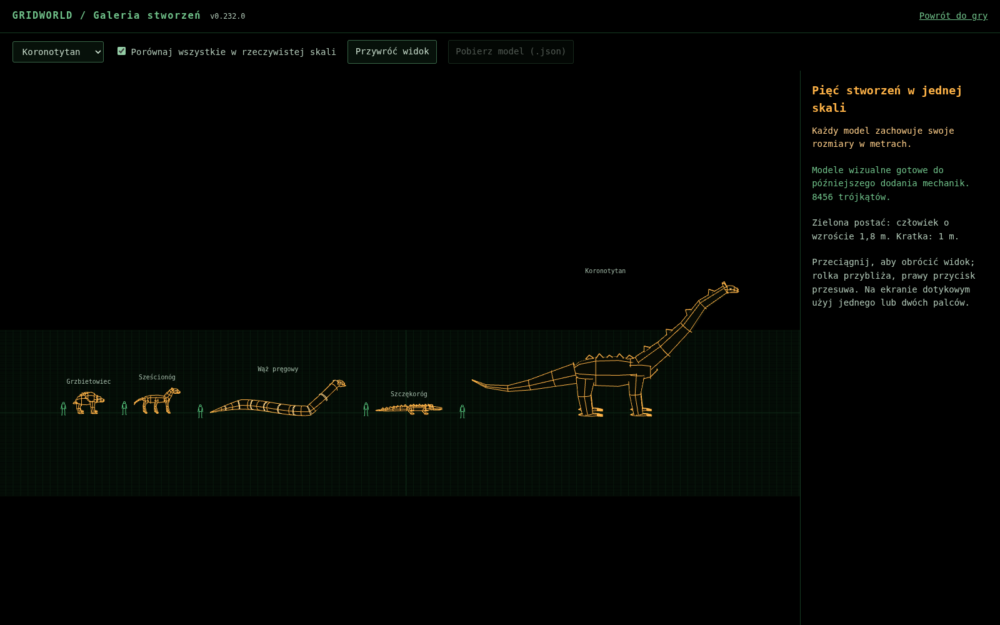

# Modele naturalnych stworzeń — 0.232.0

Pięć proceduralnych modeli 3D wykonanych w stylu Gridworld. Są częścią źródeł gry i produkcyjnego buildu. Galerię otwiera przycisk **Galeria stworzeń** w menu, albo adres `fauna.html` obok `index.html`. Lokalnie: `npm ci`, `npm run dev`, a następnie adres pokazany przez Vite z dopisanym `/fauna.html`.

W galerii można obracać i przybliżać modele, oglądać nazwy części oraz włączyć porównanie wszystkich w jednej skali. Zielona postać ma 1,8 m, kratka podłoża 1 m. Adresy konkretnych podglądów: `fauna.html#szescionog`, `fauna.html#koronotytan` oraz `fauna.html#compare`.

Przycisk **Pobierz model (.json)** zapisuje wybrany model w natywnym formacie sceny Three.js, z geometrią, materiałami, hierarchią i nazwami części. Eksport zachowuje neutralną pozycję oraz skalę metryczną; nie zawiera obrotu podglądu, siatki ani postaci porównawczej. Można go odczytać przez `new THREE.ObjectLoader().parse(json)`. Fabryki TypeScript pozostają wygodniejszym punktem integracji mechanik.

## Zasoby

| Identyfikator | Nazwa | Model |
| --- | --- | --- |
| `grzbietowiec` | Grzbietowiec — niedźwiedzia sylwetka, garb, cztery oczy, cztery łapy | [grzbietowiec.ts](../../src/models/fauna/grzbietowiec.ts) |
| `szescionog` | Sześcionóg — trzy pary nóg, rozszczepione kopyta, grzywa | [szescionog.ts](../../src/models/fauna/szescionog.ts) |
| `waz-pregowy` | Wąż pręgowy — 22 m wzdłuż osi ciała, pręgi, uniesiona głowa | [waz-pregowy.ts](../../src/models/fauna/waz-pregowy.ts) |
| `szczekorog` | Szczękoróg — krokodyla sylwetka, cztery nogi, długi pysk i ogon | [szczekorog.ts](../../src/models/fauna/szczekorog.ts) |
| `koronotytan` | Koronotytan — około 36 m długości i 18 m wysokości | [koronotytan.ts](../../src/models/fauna/koronotytan.ts) |

[Katalog i wspólny interfejs](../../src/models/fauna/index.ts), [narzędzia geometrii](../../src/models/fauna/geometry.ts), [pełny opis plastyczny](projekty.md), [plansza koncepcyjna](koncepcje.png).

Plansza jest referencją artystyczną; rysunki w osobnych kadrach mają różne powiększenia. Dokładne porównanie skali zapewnia galeria z rzeczywistymi modelami. Długość węża podano po zakrzywionej osi, a nie po jego obrysie na ziemi.



## Użycie w kodzie

```ts
import { createFaunaModel, FAUNA } from './models/fauna';

const model = createFaunaModel('szescionog');
scene.add(model.root);
model.root.position.set(x, groundY, z);
const name = FAUNA.szescionog.name; // nazwa angielska; w UI użyj tl(name)

// Dostęp do osobnych pivotów na potrzeby późniejszej animacji:
const head = model.parts.head;
const middleLeftLeg = model.parts['leg.middle.left'];

// Po zakończeniu używania:
scene.remove(model.root);
model.dispose();
```

Każde wywołanie zwraca osobną instancję geometrii, materiałów i grup. Nie ma zależności od DOM, głównej sceny, stanu gry ani sieci. Materiały należą do konkretnej instancji: jej `dispose()` nie uszkadza pozostałych modeli. Metoda jest odporna na ponowne wywołanie. Po zwolnieniu zasobów instancji nie należy ponownie wyświetlać.

Jednostka to metr; Y jest skierowane w górę, lokalne +Z do przodu. `root` stoi na gruncie Y=0, w skali 1:1. Obecne stworzenia gry mają początek w środku ciała — przy późniejszym podłączeniu należy jawnie uwzględnić tę różnicę, zamiast kopiować ich `lift`. Model nie dodaje się automatycznie do żadnej sceny ani tablicy stworzeń.

`parts` zawiera stabilne klucze: `root`, `body`, `neck`, `head`, `jaw`, `tail`; odpowiednie stworzenia mają również `mane`, `crown`, `leg.front.left`, `foot.front.left` itd. Sześcionóg ma dodatkowo `leg.middle.left/right` i `foot.middle.left/right`. Wąż nie ma nóg. Grupy głowy i szczęki są zagnieżdżone; przesunięcie szyi przenosi również głowę. Nogi mają osobne pivoty u nasad, stopy są ich dziećmi.

Podział na części jest przygotowaniem plastycznym do dalszej pracy. Ten etap nie określa sztucznej inteligencji, statystyk, obrażeń, kolizji, animacji ruchu, miejsc pojawiania się ani łupów. Katalog zasobów celowo pozostaje oddzielony od `CreatureKind`, save'ów i identyfikatorów protokołu multiplayer. Późniejsze dodanie stworzeń do symulacji wymaga jawnej integracji tych systemów.

## Sprawdzenie

`npm test` obejmuje testy anatomii, fizycznych wymiarów, poprawności buforów geometrii, hierarchii pivotów i niezależnego zwalniania zasobów. `npm run build` sprawdza TypeScript i buduje również stronę `fauna.html`. Galeria korzysta z dokładnie tych samych fabryk, które udostępnia katalog.
